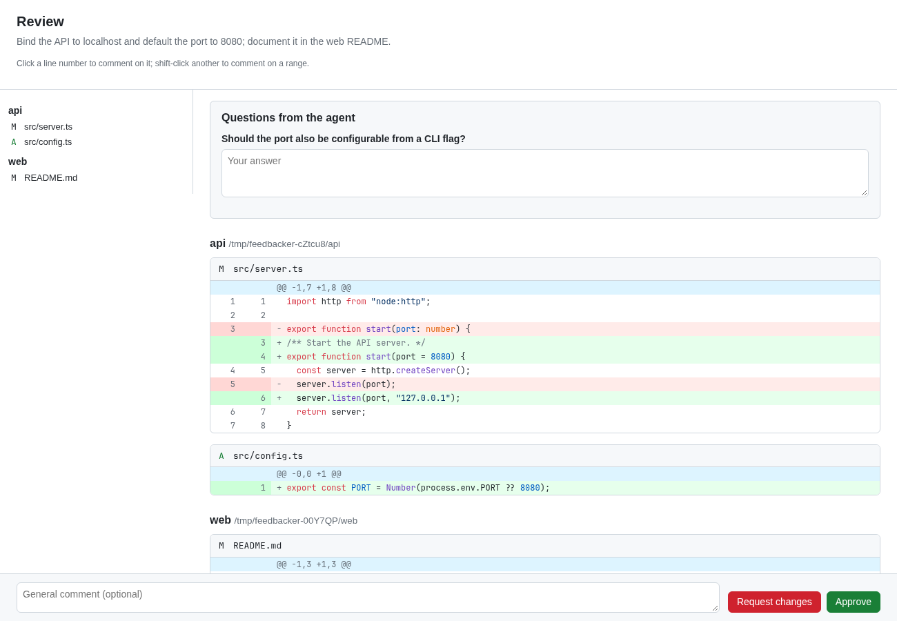

# Feedbacker

A local, merge-request-style review page for coding agents. The agent passes the git repos it changed, a summary and optionally some questions. You see the diffs of **all of them on one page**, comment on lines, answer the questions, and click **Approve** or **Request changes**. The agent gets your feedback back as markdown it can act on.

- **Multi-repo**: any repos anywhere on disk, each with its own base.
- **Simple**: one Node process, no build step, no runtime dependencies (highlight.js is vendored).
- **Local**: binds to `127.0.0.1` with a random token in the URL. Nothing leaves your machine, and git is only read.
- **Three ways in**: a Claude Code plugin (MCP tool + skill), a plain MCP server for other agents, and a CLI for anything with a shell.



## Install

### Claude Code plugin

```bash
claude plugin marketplace add PavlikPolivka/feedbacker
claude plugin install feedbacker@feedbacker
```

This gives Claude:

- the MCP tool `request_review` (it shows up as `mcp__plugin_feedbacker_feedbacker__request_review`)
- the skill `/feedbacker:review`, which tells Claude when and how to ask for a review

Then just say "let me review it" or run `/feedbacker:review`. To try it from a checkout without installing: `claude --plugin-dir /path/to/feedbacker`.

### Any MCP client

```json
{
  "mcpServers": {
    "feedbacker": { "command": "node", "args": ["/path/to/feedbacker/bin/feedbacker.mjs", "mcp"] }
  }
}
```

### CLI

```bash
git clone https://github.com/PavlikPolivka/feedbacker && cd feedbacker
npm link            # or call node bin/feedbacker.mjs directly
```

Node 20 or newer; git on `PATH`.

## Use

```bash
feedbacker ~/Projects/api ~/Projects/web@main \
  -m "Bind the API to localhost; document the port" \
  -q "Should the port also be a CLI flag?"
```

- `repo` diffs the working tree (staged, unstaged and untracked files) against `HEAD`.
- `repo@base` diffs against any commit, branch or tag, so work the agent already committed is included. Use the commit the session started from.
- The command blocks until you submit, then prints the feedback (`--json` for JSON) and exits 0. Exit 2 means there was nothing to review.
- `feedbacker list` prints the URLs of reviews waiting for you, for when the browser didn't open (MCP clients usually hide a server's output).
- `--no-open` only prints the URL; `--port` fixes the port.

In the browser:

- Click a line number to comment on that line; shift-click a second one to comment on a range. Ctrl+Enter saves, Esc cancels.
- Comments, answers and the general comment are kept in the browser's local storage until you submit, so a refresh loses nothing.
- **Approve** or **Request changes** sends everything to the agent and closes the server.

## MCP tool

`request_review`:

| Argument | Type | |
|---|---|---|
| `repos` | `[{ path, base? }]` | Required. Absolute paths; `base` defaults to `HEAD`. |
| `summary` | string | Shown at the top of the page. |
| `questions` | string[] | Shown with an answer box each. |

It blocks until the user submits (Claude Code keeps long MCP calls open; it sends progress notifications every 30 s for clients that need them) and returns markdown like:

````markdown
# Review feedback

Verdict: **changes requested**

## General

Almost there.

## Answers

**Q: Should the port also be a CLI flag?**

No, env is enough.

## Comments

### /home/me/Projects/api

**src/server.ts:6** (new side)

```diff
+  server.listen(port, "127.0.0.1");
```

Make the host configurable too.
````

Each comment carries the code it refers to, so line numbers drifting doesn't lose the context. Cancelling the tool call closes the review page.

## How it works

```
agent ──request_review / CLI──▶ feedbacker ──git diff per repo──▶ review in memory
feedbacker ──opens──▶ http://127.0.0.1:PORT/?t=TOKEN ──you submit──▶ feedbacker
feedbacker ──markdown (tool result / stdout)──▶ agent
```

| File | |
|---|---|
| `src/core.mjs` | Reads diffs (`git diff <base>` plus untracked files), parses them, serves the page, formats feedback. |
| `src/page.html` | The review page: plain JS, diff table, inline comments, highlight.js. |
| `src/mcp.mjs` | Minimal MCP server over stdio (JSON-RPC), one tool. |
| `bin/feedbacker.mjs` | CLI: review, `list`, `mcp`. |
| `skills/review/SKILL.md`, `.mcp.json`, `.claude-plugin/` | The Claude Code plugin and its marketplace entry. |

Open reviews write a small file (URL, repos, pid) to `$XDG_STATE_HOME/feedbacker/` (default `~/.local/state/feedbacker/`, mode 0600) and remove it when they finish; `list` reads them.

## Development

```bash
node --test test/*.test.mjs
```

The tests use real temporary git repos. They cover diff parsing, the HTTP server, the MCP protocol over stdio, and an end-to-end run that drives the page in headless Chromium (skipped when no Chromium is found; set `CHROMIUM=/path` to pick one).

Plans: [ROADMAP.md](ROADMAP.md).

## Licence

MIT. highlight.js (`src/vendor/`) is BSD-3-Clause; see `src/vendor/highlight.js-LICENSE`.
